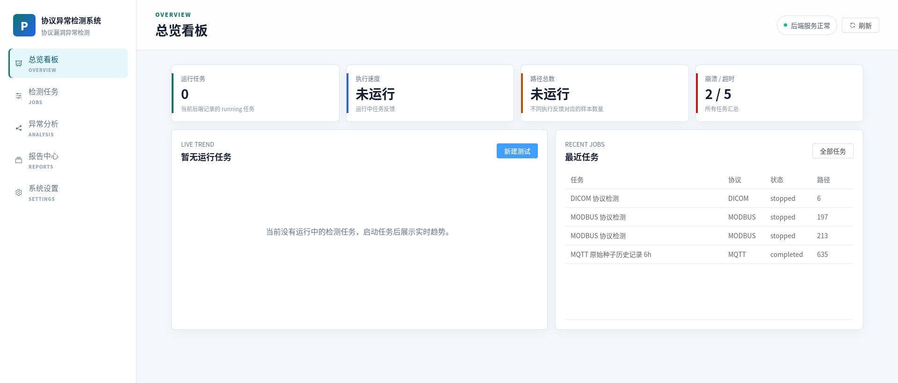
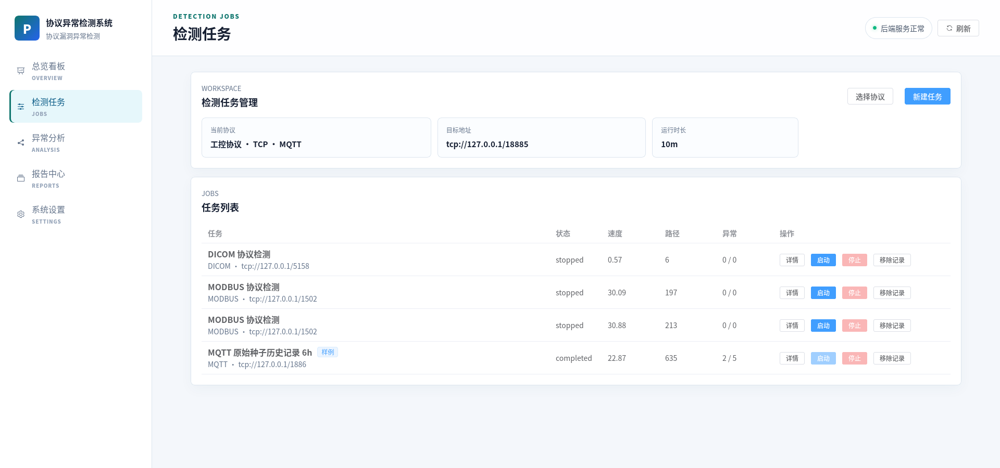
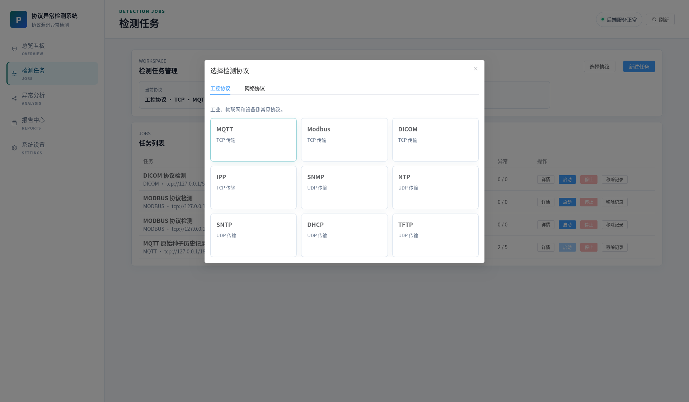
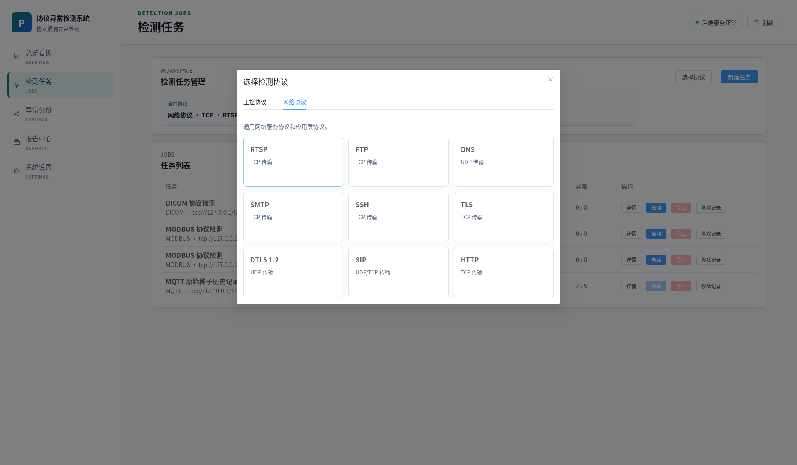
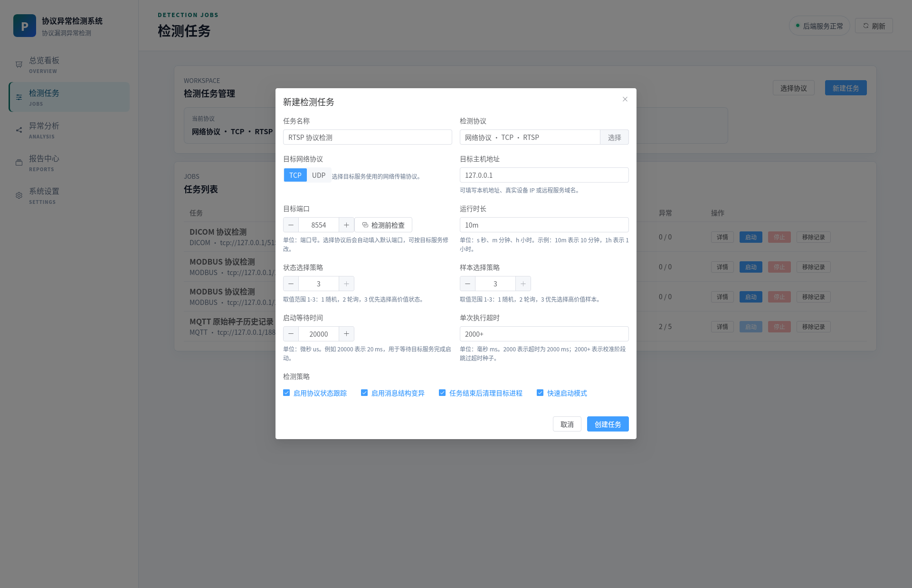
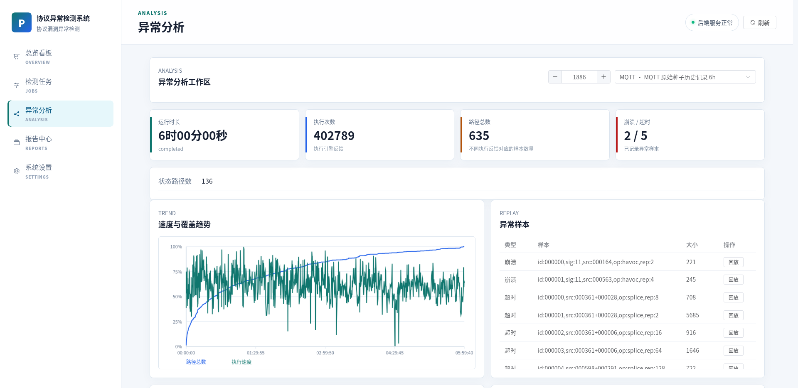
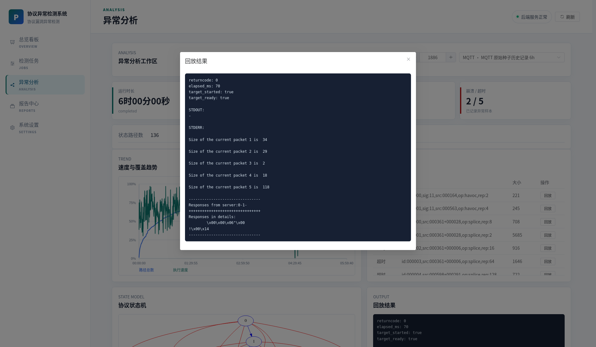
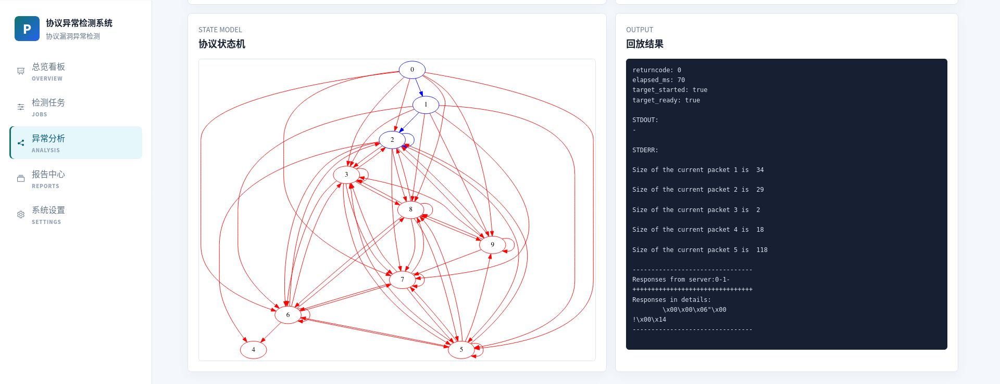
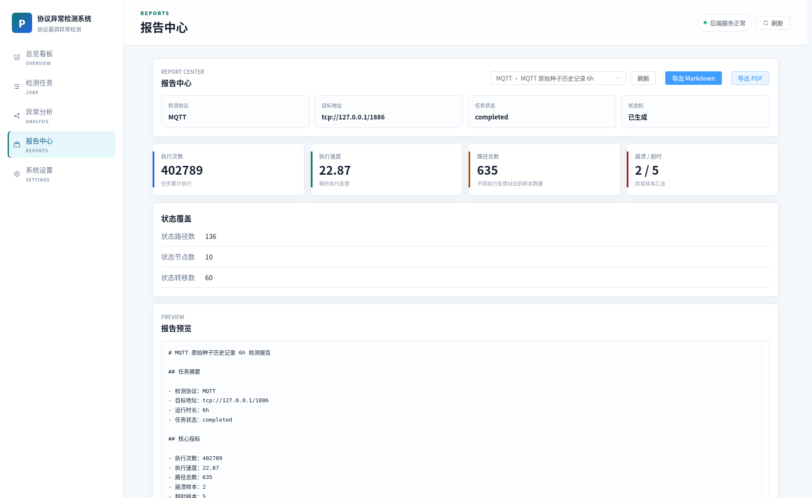
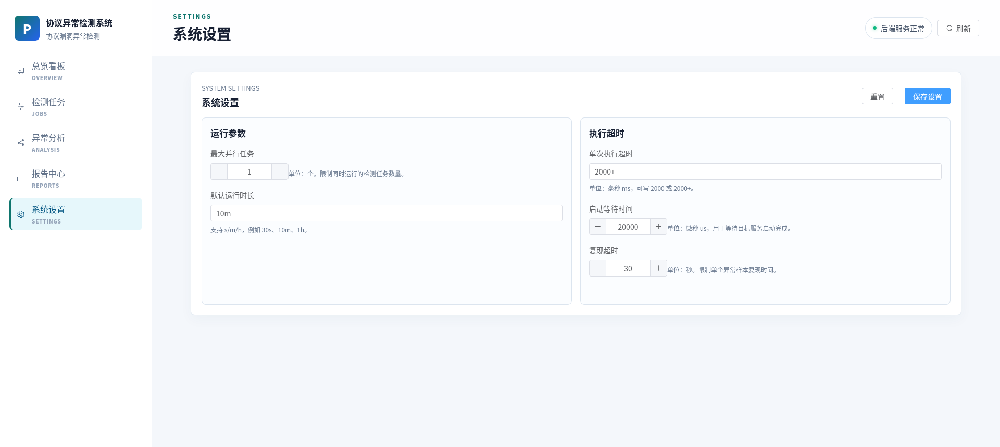

# 协议异常检测系统流程说明

本文按照总览、任务配置、协议选择、检测执行、异常分析、样本回放和报告归档的顺序介绍系统操作。当前已接入 MQTT、Modbus TCP、RTSP、FTP、DNS、DICOM、IPP 和 DTLS 1.2 的检测流程，本机参考服务的依赖准备与验证记录见[协议接入与验证](协议接入与验证.md)。

## 1. 总览看板

总览看板展示系统运行态势。左侧导航包括总览看板、检测任务、异常分析、报告中心和系统设置，右上角显示后端服务状态并提供刷新操作。顶部指标卡片展示运行任务数、运行中任务的执行速度与路径总数，以及当前任务集合的崩溃、超时汇总。

中部趋势区展示首个运行中任务的路径总数、执行速度和状态边变化；空闲时显示暂无运行任务。右侧列出最近任务，包含任务名称、协议、状态和路径数量，点击任务可进入详情。“新建测试”进入任务配置页面，“全部任务”进入任务列表。

## 2. 检测任务管理

检测任务页面顶部展示当前协议、目标地址和运行时长，并提供“选择协议”和“新建任务”入口。任务列表展示任务名称、协议、地址、状态、执行速度、路径与异常数量；具有源码行统计的任务还会显示代码行覆盖率列。初始历史任务带有“样例”标记，可用于查看分析结果和执行样本回放。

任务列表在速度列前展示实际测试时间，运行中按秒递增。列表操作提供“详情”和“移除记录”，任务启停统一在详情页操作：新建且尚未运行的任务可以“启动”，运行中的任务可以“停止”；停止、完成及历史样例任务的启动和停止按钮均保持禁用。每个任务对应一次实验，新的实验通过“新建任务”创建。移除记录仅从当前列表和汇总中移除，原始结果继续保留，便于后续复核。

## 3. 工控协议选择

点击“选择协议”打开二级弹窗，通过顶部“工控协议”和“网络协议”标签切换分类。工控协议分类中可选择 MQTT、Modbus、DICOM、IPP 等协议，卡片展示协议名称及对应的传输方式。

点击具体协议后，系统将协议类别、任务名称、传输方式和本地默认端口带入任务配置，同时应用对应的启动等待参数。后续可以根据实际目标修改主机地址、端口和运行策略，保持协议选择与任务配置连贯。

## 4. 网络协议选择

在协议弹窗中切换到“网络协议”，可选择 RTSP、FTP、DNS、DTLS 1.2 等已接入检测流程的协议。卡片采用统一布局，传输方式与所选协议保持对应，便于按目标服务确定测试类型。

选择协议后返回任务工作区，系统同步更新当前协议与目标地址。RTSP、FTP 使用 TCP，DNS、DTLS 1.2 使用 UDP；具体目标服务、初始种子和运行依赖由对应协议模板关联，后续任务通过统一入口创建和启动。

## 5. 新建检测任务

点击“新建任务”填写任务名称，确认协议，并设置目标网络协议、目标主机地址、端口和运行时长。选择本机地址时，任务使用本地参考服务；填写外部设备地址时，本机向指定设备发包。端口会根据所选协议自动填入，也可按实际服务调整。点击“检测前检查”，可查看引擎、种子、依赖、地址与端口等检查结果；外部目标还会根据协议条件进行连接和响应检查。

下方可设置状态选择与样本选择策略，取值为1至3，分别对应随机、轮询和反馈优先；启动等待时间单位为微秒，单次执行超时单位为毫秒，运行时长支持 s、m、h。超时值中的“+”表示在校准阶段跳过超时种子，例如2000+以2000 ms为超时值并启用该处理。策略区提供协议状态跟踪、消息结构变异、目标进程清理和快速启动选项。确认参数后点击“创建任务”，进入任务详情，再启动检测；本地目标由系统按协议配置启动，外部目标由设备自身提供服务。

## 6. 异常分析工作区

异常分析页面顶部用于选择任务和设置样本回放端口。指标卡片汇总运行时长、执行次数、路径总数和崩溃、超时数量，下方展示状态路径数；具备源码行统计的任务同时展示代码行覆盖率。运行中任务的时长按秒递增，统计数据与趋势按各自刷新周期更新。

趋势图展示路径总数和执行速度。横轴采用时分秒格式，纵轴采用百分比刻度，两条曲线按各自观测最大值归一化显示。代码行覆盖率以独立数值展示，表示已执行有效源码行占有效源码行总数的比例。右侧异常样本列表与选中任务关联，便于从运行趋势进入具体样本分析。

## 7. 异常样本回放

异常样本列表按崩溃和超时组织记录，展示样本名称、大小及“回放”操作。选择任务后，回放端口默认取自任务地址，也可按实际复核环境修改。点击“回放”，系统按样本原有消息序列向任务对应主机和端口发送报文，并沿用相应的 TCP 或 UDP 传输方式。

回放结果弹窗展示工具返回码、耗时、目标准备状态、标准输出和服务响应，二进制内容以转义形式保留。用户结合输出信息和目标运行记录复核异常行为；关闭弹窗后，结果继续保留在当前分析页下方的输出区域，便于对照状态图查看交互过程。

## 8. 状态机与回放输出

异常分析页面下方展示选中任务的协议状态机。节点表示根据协议响应抽象出的状态类别，有向连线表示检测中观测到的相邻状态转移；状态序列还可形成完整状态路径，分别用于观察响应类别、转移关系与连续交互的探索情况。

右侧保留最近一次回放的返回码、执行耗时、目标启动及就绪信息，以及逐包发送和响应内容。通过状态图与回放输出的对应关系，可以从总体交互结构进一步查看具体样本的消息顺序和反馈，为异常定位与后续复核提供依据。

## 9. 报告中心

报告中心按任务汇总结果。页面顶部显示协议、目标地址、任务状态和状态机生成情况；指标卡片汇总执行次数、执行速度、路径总数及异常数量；“状态覆盖”区域展示状态路径数、状态节点数和状态转移数，具备有效源码行数据时进一步展示代码行覆盖率。

下方提供 Markdown 报告预览，顶部支持刷新、导出 Markdown 和导出 PDF。PDF 按两页组织：第一页包含任务摘要、核心指标和异常样本明细，第二页展示趋势图与协议状态机。导出内容读取当前任务的统计、样本和图形数据，便于实验归档与结果交流。

## 10. 系统设置

系统设置包含运行参数和执行超时两个区域。可配置最大并行任务数1至8个、默认运行时长、单次执行超时、启动等待时间及复现超时；启动等待采用微秒，单次执行超时采用毫秒，复现超时采用秒，允许设置5至120秒。

点击“保存设置”持久化配置，最大并行数用于任务启动控制，默认运行参数用于后续任务创建，复现超时用于样本回放。协议专属的启动等待和超时默认值会在选择相应协议时应用，单个任务也可进一步调整。“重置”重新载入最近一次保存的设置，便于恢复尚未保存的修改。
